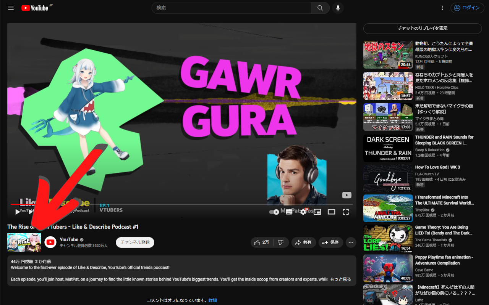
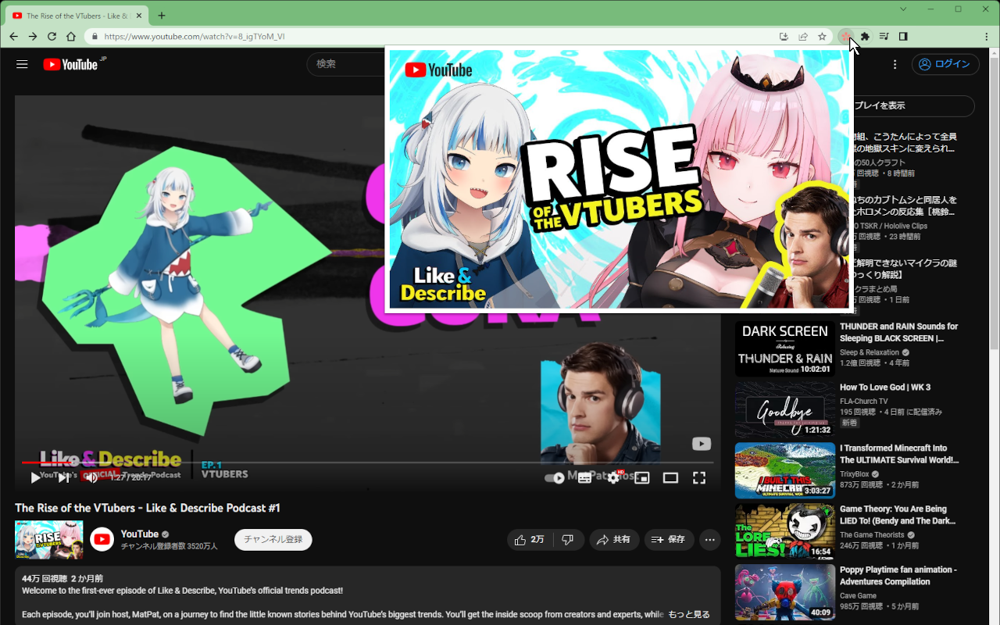

<div style="display: flex; align-items: center; gap: 1rem; margin-bottom: 2rem;">
  
  <h1 style="font-size: 2.5rem; font-weight: 700; margin: 0;">YouTube Watch Thumbnails</h1>
</div>

YouTube 動画のサムネイル画像を簡単に表示・確認できるブラウザ拡張機能です。

## 📸 スクリーンショット




## ✨ 機能概要 (Features)

- **サムネイル表示**: YouTube 視聴ページで、動画のサムネイル画像を自動的に表示します。
- **高画質対応**: WebP および JPG 形式の最高画質サムネイルを取得します。
- **ワンクリック確認**: サムネイルをクリックすると、専用ビューワーで全サイズの画像を確認できます。
- **Shorts 対応**: YouTube Shorts にも対応しています。

## 📥 インストール (Installation)

### ストアからインストール

- [](https://chromewebstore.google.com/detail/youtube-watch-thumbnails/aobeafpjgdgakpagffmlkfeognaiigci)
- [](https://addons.mozilla.org/ja/firefox/addon/youtube-watch-thumbnails/)

### ローカルで動かす場合

1. リポジトリをクローンします。
   ```bash
   git clone https://github.com/mosunset/youtube_watch_thumbnails.git
   cd youtube_watch_thumbnails
   ```

2. 依存関係をインストールします。
   ```bash
   pnpm install
   ```

3. 開発サーバーを起動します。
   ```bash
   pnpm dev
   ```

4. ブラウザに拡張機能を読み込みます。
   - **Chrome**: `chrome://extensions` を開き、デベロッパーモードを有効にします。「パッケージ化されていない拡張機能を読み込む」をクリックし、`apps/extension/.output/chrome-mv3` ディレクトリを選択します。
   - **Firefox**: `about:debugging#/runtime/this-firefox` を開き、「一時的なアドオンを読み込む」をクリックし、`apps/extension/.output/firefox-mv2/manifest.json` を選択します。

## 🚀 使い方 (Usage)

1. YouTube で動画ページ (`/watch`) または Shorts ページ (`/shorts`) を開きます。
2. チャンネルアイコンの横（または適切な位置）にサムネイル画像が表示されます。
3. 画像をクリックすると、新しいタブで「Thumbnail View」が開き、利用可能なすべてのサイズのサムネイル画像を確認できます。
4. 拡張機能アイコンをクリックすると、ポップアップに表示中の動画のサムネイルが表示されます。クリックすると Thumbnail View が開きます。

## 📂 ディレクトリ構成 (Project Structure)

```text
youtube_watch_thumbnails/
├── apps/
│   ├── extension/      # ブラウザ拡張機能本体 (WXT + React)
│   │   ├── src/        # ソースコード (entrypoints, components, utils など)
│   │   └── wxt.config.ts
│   └── docs/           # ドキュメントサイト (docsify)
│       ├── site/       # 公開される Markdown と index.html
│       └── scripts/    # リンクチェックなどのスクリプト
├── screenshots/        # スクリーンショット
└── pnpm-workspace.yaml
```

## 🛠️ 開発用コマンド (Development Commands)

- `pnpm dev`: 開発サーバーを起動します（拡張機能は HMR 有効 + ドキュメントサイト）。
- `pnpm build`: Chrome 版と Firefox 版の拡張機能をビルドし、ドキュメントのリンクを検証します。
- `pnpm lint`: ESLint（拡張機能）とドキュメントのリンク検証を実行します。
- `pnpm test`: 拡張機能の単体テスト（Vitest）を実行します。
- `pnpm test:e2e`: 拡張機能をビルドし、Chromium で E2E テスト（Playwright）を実行します。
- `pnpm release <version>`: テストしてからバージョンを上げ、タグを push します。GitHub Actions が GitHub Release の作成とストアへの提出を行います（[手順](https://mosunset.github.io/youtube_watch_thumbnails/#/ja/internals/release)）。
- `pnpm --filter extension zip`: ストア提出用の ZIP ファイルを作成します。

## 🤝 貢献方法 (Contribution)

バグ報告や機能要望は [Issues](https://github.com/mosunset/youtube_watch_thumbnails/issues) にて受け付けています。プルリクエストも歓迎します。

詳細な仕様については [こちら](https://mosunset.github.io/youtube_watch_thumbnails/) をご覧ください。

## 👤 作者 (Author)

**mosunset**

- [Blog](https://mosunset.com/blog/youtube-watch-thumbnails/)

## 📦 Store

- [](https://chromewebstore.google.com/detail/youtube-watch-thumbnails/aobeafpjgdgakpagffmlkfeognaiigci)
- [](https://addons.mozilla.org/ja/firefox/addon/youtube-watch-thumbnails/)
