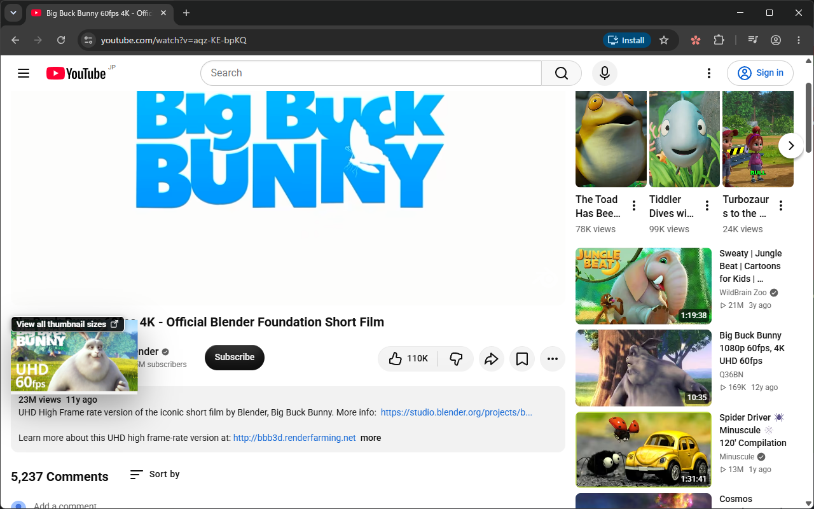
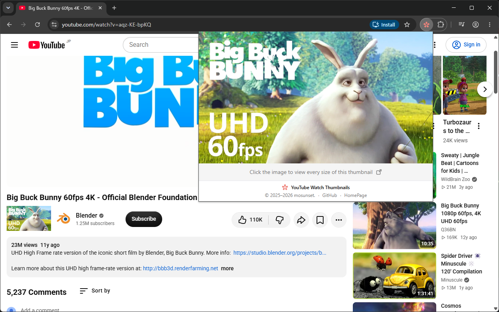
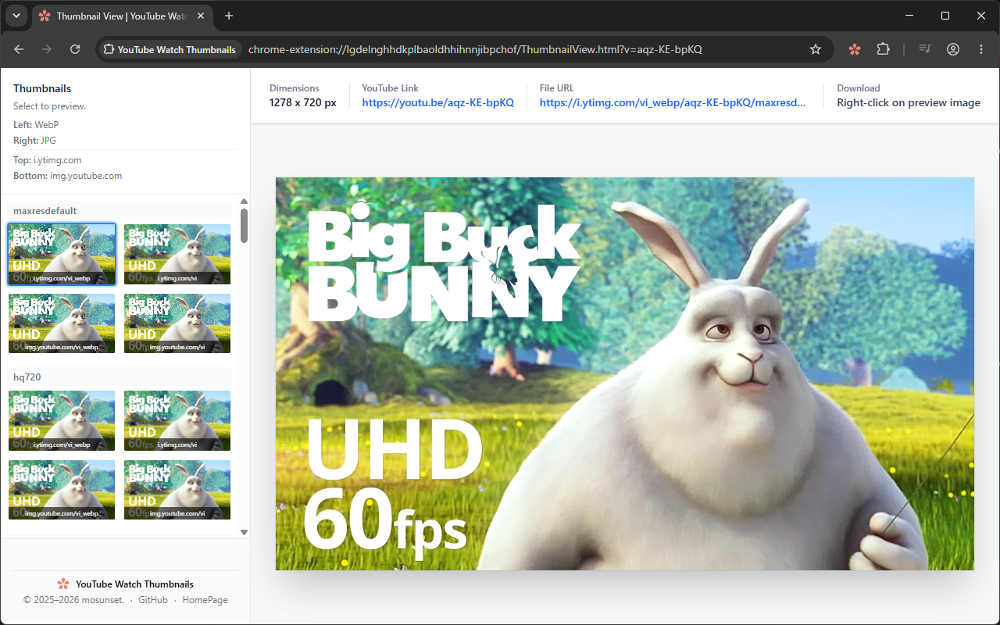

# YouTube Watch Thumbnails

A browser extension that allows you to easily view and check thumbnail images of YouTube videos.

## 📸 Screenshots

**Watch page**: the thumbnail appears next to the channel name and enlarges on hover.



**Popup**: click the toolbar icon to see the best thumbnail of the video you're watching.



**Thumbnail View**: every size and format in one place, ready to preview and save.



## ✨ Features

- **Thumbnail Display**: Automatically displays the video thumbnail on the YouTube watch page.
- **High Quality**: Retrieves maximum quality thumbnails in WebP and JPG formats.
- **One-Click Check**: Click the thumbnail to open a dedicated viewer to check images of all sizes.
- **Shorts Support**: Supports YouTube Shorts as well.

## 📥 Installation

### Install from Store

- [](https://chromewebstore.google.com/detail/youtube-watch-thumbnails/aobeafpjgdgakpagffmlkfeognaiigci)
- [](https://addons.mozilla.org/ja/firefox/addon/youtube-watch-thumbnails/)

### Run Locally

1. Clone the repository.
   ```bash
   git clone https://github.com/mosunset/youtube_watch_thumbnails.git
   cd youtube_watch_thumbnails
   ```

2. Install dependencies.
   ```bash
   pnpm install
   ```

3. Start the development server.
   ```bash
   pnpm dev
   ```

4. Load the extension into your browser.
   - **Chrome**: Open `chrome://extensions`, enable Developer Mode. Click "Load unpacked" and select the `apps/extension/.output/chrome-mv3` directory.
   - **Firefox**: Open `about:debugging#/runtime/this-firefox`, click "Load Temporary Add-on", and select `apps/extension/.output/firefox-mv2/manifest.json`.

## 🚀 Usage

1. Open a video page (`/watch`) or Shorts page (`/shorts`) on YouTube.
2. A thumbnail image will appear next to the channel icon (or an appropriate location).
3. Click the image to open "Thumbnail View" in a new tab, where you can check all available thumbnail sizes.
4. Click the extension icon to see the current video's thumbnail in the popup. Click it to open Thumbnail View.

## 📂 Project Structure

```text
youtube_watch_thumbnails/
├── apps/
│   ├── extension/              # Browser extension (WXT + React)
│   │   ├── src/
│   │   │   ├── entrypoints/    # background, content, popup, ThumbnailView
│   │   │   ├── utils/          # youtube.ts, thumbnails.ts, messaging.ts, __tests__/
│   │   │   ├── components/     # Shared React components
│   │   │   └── locales/        # en / ja / ko translations
│   │   ├── .output/            # Build artifacts (gitignored)
│   │   └── wxt.config.ts       # WXT configuration file
│   └── docs/                   # This documentation site (docsify)
└── pnpm-workspace.yaml
```

See [Architecture](/internals/architecture) for details.

## 🛠️ Development Commands

Run from the repository root (pnpm runs each app's script):

- `pnpm dev`: Start development servers (extension with HMR + docs).
- `pnpm build`: Build the extension for Chrome and Firefox, and check docs links.
- `pnpm lint`: Run ESLint (extension) and the docs link check.
- `pnpm test`: Run the extension's unit tests (Vitest).
- `pnpm test:e2e`: Build the extension and run the E2E tests in Chromium (Playwright).
- `pnpm release <version>`: Test, bump the version and push a tag; GitHub Actions creates the GitHub Release and submits to the stores (see [Releasing](/internals/release)).

More scripts are available in `apps/extension` (e.g. `pnpm --filter extension zip`). See [Build System](/internals/build).

## 🤝 Contribution

Bug reports and feature requests are welcome on [Issues](https://github.com/mosunset/youtube_watch_thumbnails/issues). Pull requests are also welcome.

For detailed specifications, please see [Specifications](/internals/specifications).

## 👤 Author

**mosunset**

- [Blog](https://mosunset.com/blog/youtube-watch-thumbnails/)

## 📦 Store

- [](https://chromewebstore.google.com/detail/youtube-watch-thumbnails/aobeafpjgdgakpagffmlkfeognaiigci)
- [](https://addons.mozilla.org/ja/firefox/addon/youtube-watch-thumbnails/)
